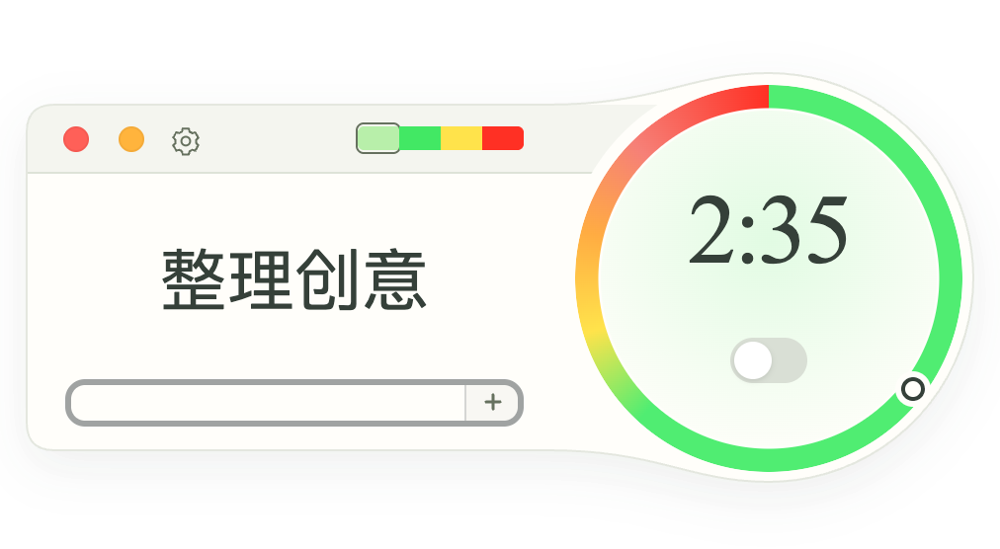

# 留白测试版V1.0

一次只做一件事的 Mac 桌面悬浮计时器。把当前任务放在左边，用右边的圆环提醒自己还剩多少时间，并为恢复留出空间。

这是第一份公开测试包，**基于留白应用 1.13**。公开测试版编号 V1.0 与应用内部版本 1.13 分开管理。

## 下载

- [下载 Mac 安装包：应用 + 六页图文手册](liubai-test-v1.0-macos-arm64.zip)
- [单独阅读图文手册](readme.pdf)
- [查看 SHA-256 校验值](SHA256SUMS)

在 GitHub 打开安装包链接后，点击文件页面的下载按钮。不要使用仓库的 “Code → Download ZIP” 代替上面的应用安装包。

## 适用的 Mac

- Apple 芯片 Mac（M1、M2、M3、M4 等；arm64）。本包不提供 Intel 版本。
- macOS 14.0 或更新版本。最低要求来自应用配置，尚未逐一验证所有系统版本和机型。
- 当前是本机签名的测试构建，尚未进行 Apple 公证；下载后首次打开可能出现系统安全提示。

## 怎么开始

1. 解压下载的安装包，打开「留白测试版V1.0」文件夹。
2. 将「留白.app」放入“应用程序”文件夹，再双击打开。图文手册也在同一文件夹里。
3. 暂停时点击左侧任务框，写下现在想做的事；按 Enter 或点击框外空白处保存。
4. 打开时间下方的开关，立即开始倒计时；再按一次暂停。拖动界面空白处可以移动小组件。

顶部红色和橙色按钮会暂停并隐藏小组件，Mac 顶部菜单栏可以重新显示；彻底退出请使用菜单栏的「退出留白」。齿轮用于调整设置。

## 可以做什么

- **只放一件事**：暂停时可以编辑，或从最近 20 条输入中选择；计时中锁定任务。
- **给恢复留时间**：四色状态默认对应 4、3、2、1 小时，每日预算最多 4 小时，最后 30 分钟留给恢复。4 小时是产品预算设定，并非人体注意力的科学上限。
- **补记离开 Mac 的用时**：点任务下方灰条右端的「+」，填写已经发生的任务和时段；保存成功才计入用量，保存或取消后都保持暂停。
- **回看实际用量**：点灰条主体打开分析，查看今天、近 7 天或近 30 天的时间分布、明细和任务分布。删除明细不会退还已经用掉的时间。
- **调整到顺手**：可以改字体、字号、文字颜色、日夜外观、状态预算、每日刷新时间和快捷键。刷新时间默认是每天 04:00，不修改就持续沿用。

最近输入最多 20 条；活动记录保留近 30 天、最多 500 段。单纯浏览分析不会暂停正在运行的计时。

## 数据与测试范围

个人任务、历史和计时进度只保存在自己的 Mac，不包含在下载包或这个公开仓库里。图片使用示例任务。本仓库仅提供成品应用、说明和预览，不包含完整项目源码与内部创意资料。

本包已检查压缩包完整性、应用签名、版本和文件校验值；实际重开应用后的任务与暂停状态保留已验证。自动启动与全局快捷键在不同机器上的表现仍需实际使用反馈。

手册末页介绍的是完整项目的文件安排；公开测试包中只需使用「留白.app」与「readme.pdf」。
